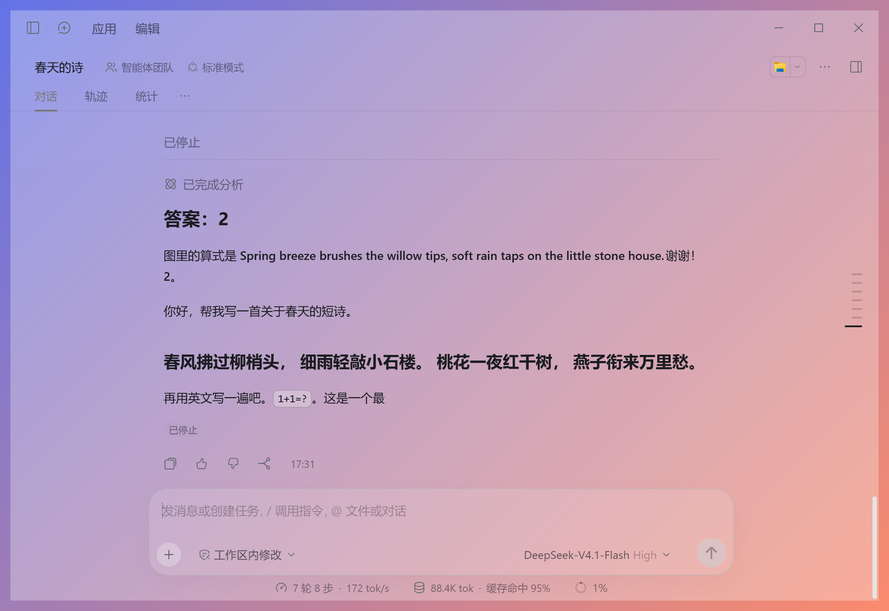
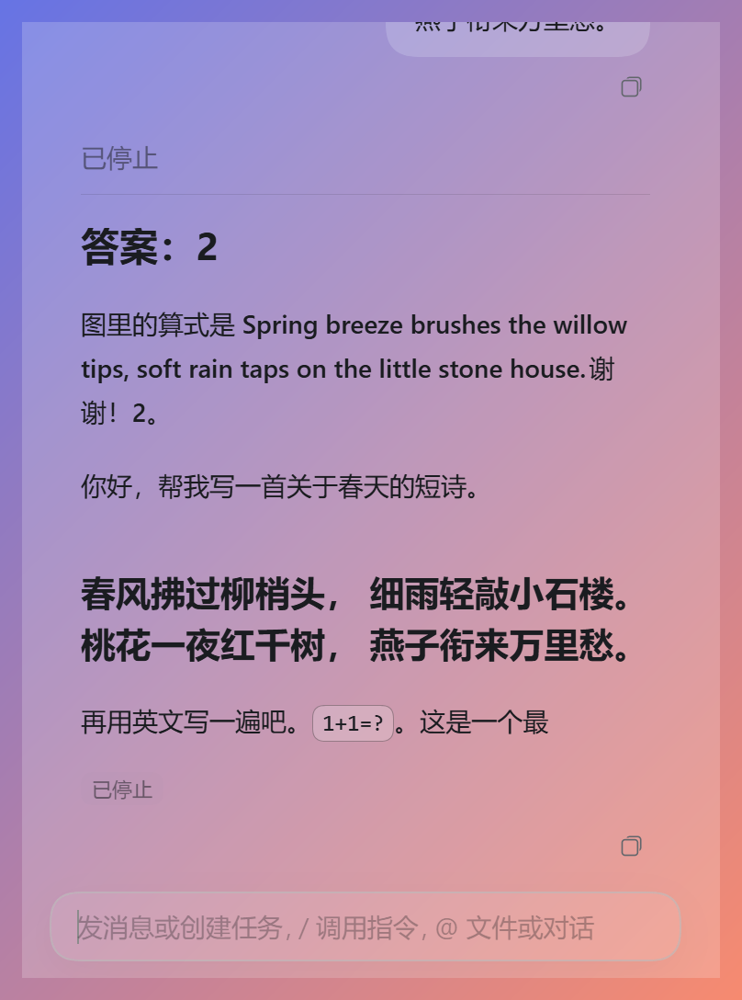

# Transparent DeepSeek

[简体中文](README.md) | **English**

Adds a transparent window to **DeepSeek Harness** (the Windows desktop app): window opacity, text opacity and text colour are three independent controls, plus a minimal mode and a "magic" mode that hides the window when it loses focus. It **does not modify any file of Harness itself**, so Harness auto-updates keep working.

| Transparent window | Minimal mode |
| --- | --- |
|  |  |

> Unofficial third-party tool, not affiliated with DeepSeek. See the [disclaimer](#disclaimer) below.

## Install in three steps

1. Download the latest `transparent-deepseek-x.y.z.zip` from [Releases](../../releases) and **unzip it anywhere** (spaces and non-ASCII characters in the path are fine).
2. Double-click `install.bat`. It finds your DeepSeek Harness installation automatically and rewrites the Harness shortcuts (Start menu / desktop / taskbar) to start the transparent version.
3. From now on, open DeepSeek Harness from those shortcuts as usual. Click "Skin settings" at the bottom-left of the sidebar or press `Ctrl+Alt+T` to adjust.

> If Harness is running, `install.bat` asks you to quit it first; you can also skip that — the next launch from a shortcut closes the old window and restarts the transparent one.

Requirements: Windows 10 / 11 with DeepSeek Harness installed.

## Features

- **Window opacity 0–100%** — only backgrounds change (including the input box). At 0% only the text floats over your desktop, and the window still receives clicks and typing. It is linear: 50% really looks half transparent.
- **Text opacity 0–100%**, independent of window opacity: chat content, the input area and the whole title bar; borders and dividers follow it.
- **Text colour**: soft presets plus a custom colour (HEX); code blocks keep their syntax colours.
- **Everything in the chat with its own background** (inline code, code blocks, tables, badges, tooltips, menus…) follows window opacity.
- **No blue**: the send button etc. become grey; the input box is a very light layer that never turns dark on focus.
- **Pasted images** show only as a faint `[Image 1]` chip in the input box (the image is still sent as an attachment).
- **Minimal mode**: only chat + input box.
  - Resize from any edge or corner (minimum 240×120); a ~10px invisible strip at the top drags the window; content wraps when narrow.
  - Only a small **Copy** button under each answer; a compact single-line input with **no send button**: `Enter` sends, `Shift+Enter` newline, `Esc` stops generation.
  - No close button. `Win+↓` minimizes; `Win+↑` does not work on a transparent window — use the tray menu "Maximize / restore window".
  - Drag the window by pressing on any **non-text** blank area (dragging on text selects it); thinking/tool-call blocks are hidden — while generating only a tiny faint ellipsis shows and disappears once the answer starts; everything returns when you leave minimal mode.
  - The settings menu fits and scrolls inside small windows; in a very small window (width < 260 or height < 300) settings open in a separate small window (click outside or press Esc to close).
- **Magic mode**: the whole window fades out when it loses focus (it still blocks clicks) and comes back instantly, with no white flash.

### Shortcuts (global, also work while the window is hidden)

| Shortcut | Action |
| --- | --- |
| `Ctrl+Alt+T` | Open / close the skin settings menu |
| `Ctrl+Alt+M` | Toggle magic mode |
| `Ctrl+Alt+0` | Reset everything to the original look |

Tray icon menu: skin settings / magic mode / reset / minimize window / maximize-restore window / quit. Settings are saved to `settings.json` in the tool folder; defaults are window 100%, text 100%, minimal off.

## Uninstall

Double-click `uninstall.bat`: it restores all original shortcuts (the originals are kept in the `backup` folder). Afterwards the original shortcuts start plain DeepSeek Harness. To remove completely, quit Harness and delete the tool folder.

## FAQ

**"DeepSeek Harness not found"?**
`install.bat` checks, in order: the registry uninstall entry → Start menu / desktop shortcuts → common install locations → a file picker asking you to choose `DeepSeek Harness.exe`. The result is stored in `config.json` in the tool folder and every script reads it. To re-detect, delete `config.json` and run `install.bat` again.

**It stopped working after a Harness update?**
An auto-update may regenerate the shortcut as the original. Run `install.bat` again. The tool also re-checks and repairs the shortcuts on every start, and if the Harness install location changed, the launcher re-detects it automatically. If a new UI element is not transparent, the update changed Harness's UI structure — please open an issue.

**How do I get the original look back?**
Temporarily: press `Ctrl+Alt+0` or choose "Reset" in the tray menu. Permanently: run `uninstall.bat`.

**The window is invisible?**
Magic mode may be on (the window hides when unfocused), or opacity is 0. Press `Ctrl+Alt+0`.

**Antivirus warning?**
The tool uses PowerShell scripts to rewrite shortcuts and the Node debugging connection to inject styles; this is fairly low-level behaviour and some security software may flag it. The full source is in the folder.

## What it does and which ports it opens (security)

The tool injects styles through Electron's debugging interfaces. Exactly what happens:

1. Harness is started with `--inspect-brk` and `--remote-debugging-port`, **both bound to `127.0.0.1` only, on a random free port chosen at every start** — no fixed ports.
2. `--inspect-brk` (the Node debugger, which can run code in Harness's main process) **is open only for the few hundred milliseconds of injection**. Afterwards the tool opens a control channel inside the Harness main process — a **named pipe with a random name plus a random token** — and immediately closes the inspector.
3. The page debugging port (`--remote-debugging-port`) **has to stay open** while Harness runs, because styles are injected through it and settings come back through it (127.0.0.1 only, random port). **Risk:** other programs on this PC could in theory connect to it. If that is not acceptable to you, do not use this tool.
4. The tool's own single-instance control port is also random + 127.0.0.1 only + token-protected. The ports, pipe name and token are stored in `run.json` in the tool folder — do not share that file.
5. The tool **does not use the network, upload anything, or create startup entries / scheduled tasks** (unless you run `node shortcuts.js install --login-repair` yourself), and **does not modify any Harness file** (including `app.asar`); it only rewrites shortcuts (originals are backed up).
6. Note: Harness itself also opens a local-only Node inspector (e.g. port 9230); that one belongs to the app, not to this tool.

## How it works (short)

`launcher.js` starts Harness and runs `hook.js` before `main.js` (creating the main window transparent, removing the native window buttons so the page draws its own, tracking focus for magic mode), then injects `inject.js` over CDP. Window opacity does not use `SetLayeredWindowAttributes`; every large background is rewritten to `rgba(original, opacity)` (only the bottom layer carries alpha, so it is linear). `detect.ps1` finds Harness, `shortcuts.js` + `shell.ps1` back up / rewrite / restore shortcuts, `helper.ps1` provides global hotkeys and the tray icon.

## Disclaimer

- This is an **unofficial** third-party tool, not affiliated with or endorsed by DeepSeek.
- It depends on Harness's current internals (Electron debugging interface, UI CSS class names). **It may stop working after a DeepSeek update**; use `uninstall.bat` or `Ctrl+Alt+0` to get back to the original.
- The software is provided "as is", without warranty of any kind; use at your own risk (see [LICENSE](LICENSE)).

## License

[MIT](LICENSE)
