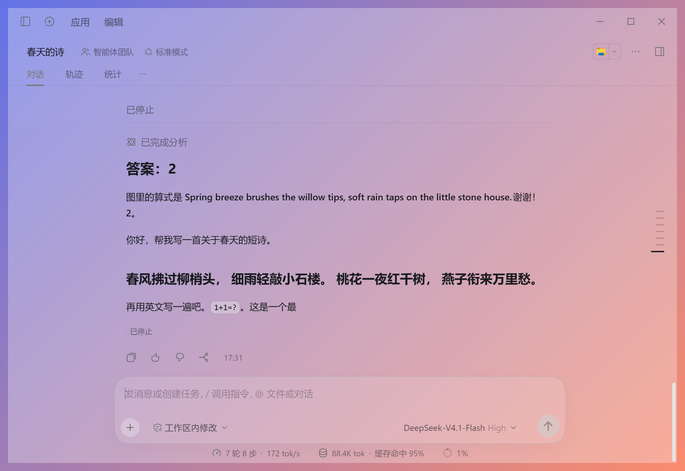
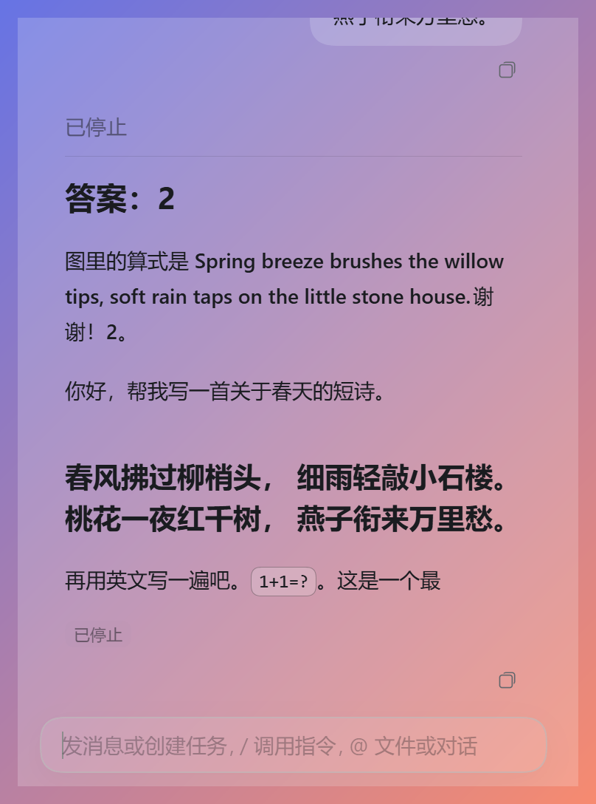

# 透明版 DeepSeek

**简体中文** | [English](README.en.md)

给 **DeepSeek Harness**（Windows 桌面版）加上透明窗口：窗口透明度、文字透明度、字体颜色三个独立可调，另有极简模式和「失焦自动隐身」的魔术模式。**不修改 Harness 本身的任何文件**，Harness 自动更新不受影响。

| 透明窗口 | 极简模式 |
| --- | --- |
|  |  |

> 非官方第三方工具，与 DeepSeek 官方无关。见底部[免责声明](#免责声明)。

## 三步安装

1. 在 [Releases](../../releases) 下载最新的 `transparent-deepseek-x.y.z.zip`，**解压到任意文件夹**（路径里有空格、中文都可以）。
2. 双击 `install.bat`。它会自动找到 DeepSeek Harness 的安装位置，并把开始菜单 / 桌面 / 任务栏上的 Harness 快捷方式改成透明版。
3. 以后照常从快捷方式打开 DeepSeek Harness 就是透明版。点侧边栏左下角的「皮肤设置」，或按 `Ctrl+Alt+T` 调整。

> 如果 Harness 当前正在运行，`install.bat` 会提示你先退出；不退出也行，下次从快捷方式打开时会自动关掉旧窗口、用透明版重开。

要求：Windows 10 / 11，已安装 DeepSeek Harness。

## 功能

- **窗口透明度 0–100%**：只改背景（包括输入框底色）。0% 时只剩文字浮在桌面上，窗口仍然能正常点击和输入。是线性的：50% 看起来就是一半透明。
- **文字透明度 0–100%**：和窗口透明度完全独立，作用于聊天内容、输入区、整条标题栏；边框和分割线跟它走。
- **字体颜色**：柔和预设色 + 自定义取色（HEX 输入），代码块保留语法高亮配色。
- **聊天里自带底色的元素**（行内代码、代码块、表格、徽标、提示框、菜单……）都跟窗口透明度走。
- **去蓝色**：发送按钮等改成灰色；输入框是很淡的一层，聚焦也不会变黑。
- **粘贴的图片**在输入框里只显示一个很淡的「[图片1]」小标签（图片仍正常作为附件发送）。
- **极简模式**：只留聊天区 + 输入框。
  - 窗口四边四角都能拖动缩放（最小 240×120），顶部约 10px 隐形区域用来拖动窗口；窗口变窄时内容自动换行。
  - 回答下面只留一个小的「复制」键；输入框单行紧凑、**没有发送键**：`Enter` 发送，`Shift+Enter` 换行，生成中按 `Esc` 停止。
  - 没有关闭键。`Win+↓` 最小化；`Win+↑` 在透明窗口上无效，请用托盘图标右键菜单的「最大化 / 还原窗口」。
- **魔术模式**：窗口失去焦点时整个窗口渐隐到看不见（仍然挡住点击），点回来立刻恢复，没有白闪。

### 快捷键（全局，窗口隐身时也有效）

| 快捷键 | 作用 |
| --- | --- |
| `Ctrl+Alt+T` | 打开 / 关闭皮肤设置菜单 |
| `Ctrl+Alt+M` | 开 / 关魔术模式 |
| `Ctrl+Alt+0` | 立刻恢复原样（透明度、文字、极简、魔术全部复位） |

托盘图标右键菜单：皮肤设置 / 魔术模式 / 恢复原样 / 最小化窗口 / 最大化·还原窗口 / 退出美化工具。设置保存在工具文件夹里的 `settings.json`，默认是窗口 100%、文字 100%、极简关。

## 卸载

双击 `uninstall.bat`：恢复所有原来的快捷方式（原件在 `backup` 文件夹里）。之后用原来的快捷方式打开就是原版 DeepSeek Harness。想彻底删除，关闭 Harness 后删除整个工具文件夹即可。

## 常见问题

**提示找不到 DeepSeek Harness？**
`install.bat` 依次检查：注册表里的卸载项 → 开始菜单 / 桌面快捷方式 → 常见安装位置 → 弹窗让你自己选择 `DeepSeek Harness.exe`。选择后路径会记在工具文件夹里的 `config.json`，之后所有脚本都读它。想重新检测，删掉 `config.json` 再运行 `install.bat`。

**Harness 更新之后不透明了？**
自动更新可能把快捷方式重新生成成原版。再运行一次 `install.bat` 即可。工具本身每次启动时也会自动检查并修好快捷方式；如果更新后 Harness 的安装位置变了，启动器会自动重新检测。如果某个新界面元素没变透明，是程序更新改了界面结构，欢迎提 issue。

**怎么恢复原样？**
临时：按 `Ctrl+Alt+0`（透明度、文字、极简、魔术全部复位），或在托盘菜单里选「恢复原样」。永久：运行 `uninstall.bat`。

**窗口变得看不见了？**
可能开着魔术模式（窗口失焦会隐身）或窗口透明度/文字透明度调到了 0。按 `Ctrl+Alt+0` 恢复。

**杀毒软件报警？**
工具用 PowerShell 脚本改快捷方式、用 Node 调试连接注入样式，行为较「底层」，个别安全软件可能提示。源码全部公开，都在文件夹里，可自行检查。

## 它做了什么、开了什么端口（安全说明）

工具通过 Electron 的调试接口注入样式，下面是它实际做的事：

1. 用 `--inspect-brk` 和 `--remote-debugging-port` 启动 Harness，**都只绑定 `127.0.0.1`，端口是每次启动随机选的空闲端口**，不用固定端口。
2. `--inspect-brk`（Node 调试口，可以在 Harness 主进程里执行代码）**只在注入的那几百毫秒里开着**：注入完成后，工具在 Harness 主进程里开一个「随机名字的命名管道 + 随机令牌」作为控制通道，然后立刻关掉这个调试口。
3. 页面调试口（`--remote-debugging-port`）**必须一直开着**才能把样式注入页面、接收设置，所以它在 Harness 运行期间保持监听（仅本机 127.0.0.1、随机端口）。**风险提示**：本机上的其他程序理论上能连上这个端口。如果你不接受，可以不要使用本工具。
4. 工具自己的「单实例」控制端口也是随机端口 + 仅 127.0.0.1 + 令牌；端口、管道名、令牌写在工具文件夹的 `run.json` 里，请不要分享这个文件。
5. 工具**不联网、不上传任何数据、不创建开机自启项或计划任务**（除非你手动运行 `node shortcuts.js install --login-repair`），**不修改 Harness 的任何文件**（包括 `app.asar`），只改快捷方式（原件已备份）。
6. 注意：Harness 自己也会开一个仅本机的 Node 调试口（如 9230），那是它自带的，不是本工具开的。

## 工作原理（简要）

`launcher.js` 启动 Harness 并在 `main.js` 之前执行 `hook.js`（让主窗口以透明方式创建、去掉原生窗口按钮改由页面自己画、监听焦点做魔术模式），再通过 CDP 把 `inject.js` 注入页面。窗口透明度不用 `SetLayeredWindowAttributes`，而是把每一层大面积背景色改成 `rgba(原色, 透明度)`（只有最底层带 alpha，所以是线性的）。`detect.ps1` 负责自动找 Harness，`shortcuts.js` + `shell.ps1` 负责备份 / 改写 / 恢复快捷方式，`helper.ps1` 提供全局快捷键和托盘图标。

## 免责声明

- 本项目是**非官方**的第三方工具，与 DeepSeek 官方无关，也未获得其认可。
- 它依赖 Harness 当前的内部结构（Electron 调试接口、界面 CSS 类名）。**DeepSeek 更新后可能失效**，失效时用 `uninstall.bat` 或 `Ctrl+Alt+0` 即可回到原版。
- 软件按「现状」提供，不提供任何担保，使用风险自负（详见 [LICENSE](LICENSE)）。

## 许可证

[MIT](LICENSE)
